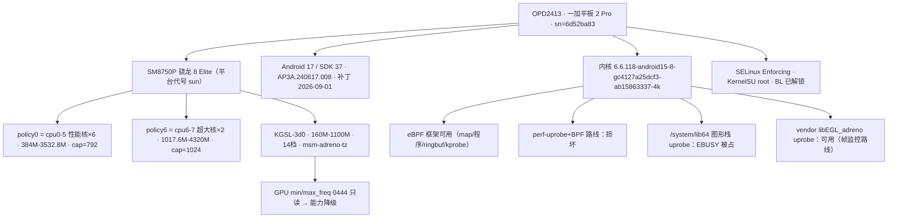

# 设备知识树 · 一加平板 2 Pro（OPD2413）

- 序列号：`6d52ba83`
- 采集日期：2026-10-25（adb 只读 + su root；当晚追加帧监控路线实测）
- 用途：「一个调度」模块在这台设备上的权威设备数据源。开发/排障先查本文件，避免重复探索。
- 所有数值均附来源节点/命令，可用文末「复验指南」重新采集比对。重大排障前建议重采并 diff。

## 0. 总览



## 1. 身份层

| 项 | 值 |
|---|---|
| 上市名 | 一加平板 2 Pro |
| 型号 / device | OPD2413 / OP615EL1 |
| 品牌 / 厂商 | OnePlus |
| SoC | SM8750P（QTI，骁龙 8 Elite），内核平台代号 `sun` |
| Android / SDK | 17 / 37 |
| Build ID | AP3A.240617.008 |
| 安全补丁 | 2026-09-01 |
| ABI | arm64-v8a |
| Fingerprint | `OnePlus/OPD2413/OP615EL1:17/AP3A.240617.008/V.4f9d5e9-295579e-2979914:user/release-keys` |
| 内核 | 6.6.118-android15-8-gc4127a25dcf3-ab15863337-4k |
| Root | KernelSU（`su` → uid 0；管理器 me.weishu.kernelsu） |
| SELinux | Enforcing |
| Bootloader | 已解锁（`oplusboot.verifiedbootstate=orange`） |

`/proc/cmdline` 关键项：`cpufreq.default_governor=performance`（开机默认，运行时被 walt 接管）、`irqaffinity=0-1`、`rcu_nocbs=0-7`、`kpti=0`、`swiotlb=0`、`cgroup_disable=pressure`（PSI 关闭）、`sched_pelt_multiplier=4`、面板 `mdss_dsi_panel_XN242_P_D_A0024_vid`、触控 `novatek,nf_nt36536`、`oplusboot.serialno=6d52ba83`。

对本项目的意义：BL 解锁 + KSU 是模块可运行的前提；GPU 频率节点只读是驱动级设计而非 SELinux（见第 3 节与坑 #3）；Android 17 决定了 libgui 符号现状（见 8.2——符号虽在但挂不上探针，见 8.1）。

## 2. CPU 树

```
/sys/devices/system/cpu/cpufreq/
├── policy0（related_cpus = 0 1 2 3 4 5，6×性能核）
│   governor: walt（可用: scx walt conservative powersave performance schedutil）
│   16 档: 384000 556800 748800 960000 1152000 1363200 1555200 1785600
│          1996800 2227200 2400000 2745600 2918400 3072000 3321600 3532800
│   实测: min=556800 max=2400000 cur=1363200（hw 范围 384000-3532800）
│   cpu_capacity = 792（cpu0-5）
└── policy6（related_cpus = 6 7，2×超大核）
    governor: walt（同上）
    16 档: 1017600 1209600 1401600 1689600 1958400 2246400 2438400 2649600
           2841600 3072000 3283200 3513600 3801600 4089600 4204800 4320000
    实测: min=1017600 max=2649600 cur=1017600（hw 范围 1017600-4320000）
    cpu_capacity = 1024（cpu6-7）
```

对本项目的意义：
- `cpu.min_freq.pN` / `fps.steps.pN` 的 N = policy 枚举序（nodes.cpp 按首 cpu 排序）：**p0=policy0（6 性能核），p1=policy6（2 超大核）**，只有两组，没有第三个 cluster
- 节点路径：`/sys/devices/system/cpu/cpufreq/policy{0,6}/scaling_min_freq`
- 档位不写 governor 时由系统 walt 自治；WALT idle 时会压低 scaling_min，曾有回读不一致重试（2026-10-25 00:08 日志）——nd_write 的重试机制即为此设计

## 3. GPU 树

```
/sys/class/devfreq/3d00000.qcom,kgsl-3d0
  governor: msm-adreno-tz
  14 档（MHz）: 160 222 342 389 443 525 607 660 734 832 900 967 1050 1100
  实测: min=160 cur=160 max=1100
/sys/class/devfreq/kgsl-busmon  （governor=gpubw_mon，GPU 带宽监视）
```

对本项目的意义：
- daemon 写 GPU 频率的路径 `/sys/class/kgsl/kgsl-3d0/devfreq/{min,max}_freq` 在此设备均为 **0444 只读**（2026-10-25 `ls -la` 实测）——sysfs 属性无 store 回调即驱动级阉割：root/CAP_DAC_OVERRIDE 也写不了、chmod 无效、瞬时 permissive 无效（00:08 日志的 Permission denied 正是此因，**不是 SELinux 问题**）→ `gpu` 能力降级，game 档 GPU 维度实际不干预
- 同目录 `governor` 可写但无干预意义；GPU 频率完全交给 Adreno TZ（温控驱动）自治，本项目不要指望 GPU 频率维度

## 4. 温控树

- 80 个 thermal_zone（`/sys/class/thermal/thermal_zone0-79`）：
  - CPU：`cpu-0-0-0 … cpu-0-5-1`（policy0 每核 2 区）、`cpu-1-0-0 … cpu-1-1-1`（policy6 每核 2 区）、`cpuss-0-0/1`、`cpuss-1-0/1`
  - GPU：`gpuss-0 … gpuss-7`
  - 其他：`mdmss-0-3`、`camera-0/1`、`video`、`ddr`、`socd`、`shell_front/shell_frame/shell_back`、`sys-therm-2/3`、`battery`、`usb_therm/usb`、`pm8550-bcl-lvl0/1/2`、`pmih010x-{ibat,bcl}-lvl0/1/2`、`pm8550ve_d/f/g/i_tz`、`pm8550vs_j_tz` 等
- 采集时温度：CPU 区 33~43°C（最热 cpu-0-2-0=43°C），外壳 31°C，soc/ddr ~33-38°C
- 36 个 cooling_device：`cpufreq-cpu0`、`cpu-hotplug0/2/3`、`pause-cpu0-7`、`thermal-pause-*`、`ufs`、`display-fps`、`ddr-cdev`、`gpu-dump-skip-cdev`、`cpu-cluster0/1`、`kgsl`

对本项目的意义：
- `thermal_tick` 取**全部 zone 的最高温**（nodes.cpp `read_max_temp`，含电池/PMIC 区——`TEMP=61` 完全可能是电池区而非 CPU）
- live `TEMP` = 最高 zone 毫秒值 / 1000（℃）；`THERM=1` 时 daemon 写各 policy 的 `scaling_max_freq` 封顶（采集时 live 正是 THERM=1/TEMP=61）
- 封顶/恢复阈值走配置 `thermal.cap_temp` / `thermal.recover_temp`

## 5. cgroup / cpuset 树

- cgroup v2 统一挂载：`/sys/fs/cgroup`（memory_recursiveprot）
- v1 遗留挂载：`/dev/blkio`、`/dev/cpuctl`、`/dev/cpuset`（cpuset_v2_mode）、`/dev/freezer`
- cpuset 组（`/dev/cpuset/<grp>/cpus`）：

| 组 | cpus |
|---|---|
| top-app / foreground / foreground_window / restricted / sf / display / camera-daemon / audio-app / kswapd-like | 0-7 |
| h-background | 0-5 |
| background / system-background / l-background / storage_occupied | 0-3 |
| limited | 1-5 |
| camera-background | 0 |

对本项目的意义：
- `cpuset.top_app_cpus` 等键落 `/dev/cpuset/<grp>/cpus`；top-app 已 0-7 全开，cpuset 维度干预空间有限
- **thread.bind 维度实测失败**（RenderThread 期望 6-7 回读不一致，2026-10-25 00:08 日志）→ `threads` 能力降级，绑核暂不可用

## 6. 内存 / 存储

- MemTotal 11,725,440 kB ≈ 11.2 GiB（12GB 版）
- SwapTotal 13,631,480 kB ≈ 13 GiB（ZRAM）
- `vm.swappiness=40`、`vm.dirty_ratio=10`
- 存储：UFS（sda-sdf 六个块设备，rotational=0），`read_ahead_kb=128`，调度器可用 none / deadline / kyber / bfq（输出中方括号丢失，精确集合待复验）

对本项目的意义：
- `io.read_ahead_kb` 键落 `/sys/block/*/queue/read_ahead_kb`（sda-sdf 均存在）
- `mem.swappiness` / `mem.dirty_ratio` 节点（`/proc/sys/vm/`）可写

## 7. 显示树

- 物理分辨率 2400×3392（xDpi≈315.9）
- 支持刷新率：**144 / 120 / 90 / 72 / 60 / 50 / 48 Hz**（`mSupportedRefreshRates`）
- `DisplayMode{id=0}`：2400×3392，peak/vsync 120Hz，appVsyncOffset 1ms，**presentationDeadlineNanos=11333333（11.33ms）**
- HDR 类型 [4,1,2,3]（Dolby Vision / HDR10+ / HDR10 / HLG）

对本项目的意义：稳帧上限参考 120/144Hz；`presentationDeadlineNanos` 是帧截止时间的现成来源；实时帧率信号走 8.4 的 adreno uprobe 路线（多数游戏锁 60/120）。

## 8. 内核能力树

### 8.1 eBPF / uprobe 判定（2026-10-24 探针 + 2026-10-25 tracefs 实测）

| 路线 | 状态 | 证据 |
|---|---|---|
| bpf() BPF_MAP_CREATE（RINGBUF） | ✅ | map 创建成功 |
| BPF_PROG_LOAD（KPROBE 类型 + ringbuf helpers） | ✅ | verifier 全过（注意 map fd 加载要 `src_reg=BPF_PSEUDO_MAP_FD(1)`，否则 EACCES） |
| ringbuf mmap 消费 | ✅ | libbpf 分段映射法（consumer 页单独 RW 恰好 1 页） |
| kprobe 触发 | ✅ | 抓到内核线程事件 |
| **perf_event_open(uprobe PMU) + SET_BPF 触发** | ❌ **损坏** | event/SET_BPF/ENABLE 全成功但程序永不触发；sample_period=1、pid 过滤、cpu=-1、自研靶子 100 次调用均 0 事件 |
| **tracefs uprobe（自研靶子对照）** | ✅ 可用 | uprobe_profile 命中 2141+ 次持续增长；同进程同刻 perf 路线 0 事件 |
| **/system/lib64 图形栈 uprobe**（libgui/libEGL/libGLESv2） | ❌ **EBUSY 被占** | 注册即 Device or resource busy（libgui 两个偏移、libEGL、libGLESv2 全挡）；同目录 libc.so 却能挂 → 图形栈被精准占位，疑 OPPO 游戏帧追踪已占位 |
| **/vendor/lib64/libEGL_adreno.so uprobe** | ✅ **可挂且每帧触发** | `eglSwapBuffers@0x9ed0` 注册成功；方舟前台 3 秒 182 命中 = 60.67fps（2026-10-25 晚） |
| trace 缓冲记录动态事件 | ❌ 不记录 | `tracing_on=1` 也不进缓冲（trace 仅 12 行文件头）；uprobe_profile 计数器照常走 |
| trace_pipe 读取 | ❌ EBUSY | Perfetto（traced/traced_probes）常驻占用唯一 reader 位 |
| trace 实例（`instances/<名>/uprobe_events`） | ❌ EACCES | 实例可建、tracing_on 可写，但 uprobe 事件拒写 |
| uprobe_profile 计数器 | ✅ 可靠 | 唯一可用的事件消费途径 |

- uprobe PMU type=9，kprobe PMU type=8
- BTF：`/sys/kernel/btf/vmlinux`，6,118,877 B（每次启动重新生成，mtime=本次开机时间）
- `unprivileged_bpf_disabled=0`
- 判定：**eBPF 框架可用，但 perf-uprobe+BPF 派发被阉割（aya/fas-rs 死刑），且动态 uprobe 事件不进任何可读缓冲（只有计数器）**；帧感知唯一可行路线见 8.4

### 8.2 libgui.so 符号现状（2026-10-25 `nm -D /system/lib64/libgui.so` 复核）

fas-rs 的硬编码目标（均不存在）：
- `_ZN7android7Surface11queueBufferEP19ANativeWindowBufferi` ❌
- 旧版 fallback `...PNS_24SurfaceQueueBufferOutputE` ❌

现存可用入口（vaddr = 文件偏移，LOAD 段 Offset==VirtAddr）：

| 符号 | 偏移 |
|---|---|
| `android::Surface::queueBuffer(sp<GraphicBuffer> const&, sp<Fence> const&, SurfaceQueueBufferOutput*)` | 0x170764 |
| `android::Surface::queueBuffer(sp<GraphicBuffer> const&, SurfaceQueueBufferInput const&, SurfaceQueueBufferOutput*)` | 0x172b58 |
| `android::Surface::queueBuffers(vector<BatchQueuedBuffer>…)` | 0x172bf8 |
| `android::BufferQueueProducer::queueBuffer(int, IGraphicBufferProducer::QueueBufferInput const&, QueueBufferOutput*)` | 0x135af0 |
| `android::BLASTBufferQueue::dispatchBqpSyncTransactionFromProducer(…)` | 0x187540 |
| `android::libguiextension::QtiBufferQueueProducerExtension::qtiQueueBuffer(…)` | 0x1f9c70 |

对本项目的意义：~~自研帧监控挂 0x170764 或 0x135af0~~——**libgui 系符号虽在，但 uprobe 注册被 EBUSY 挡（见 8.1），本表仅留证符号存在性；帧监控实际走 8.4 的 vendor adreno 路线。**

### 8.3 debugfs / tracefs / fas_rs 现状

- debugfs：挂于 `/sys/kernel/debug`（rw），可 root 挂载
- tracefs：`/sys/kernel/tracing` 与 `/sys/kernel/debug/tracing`（rw，gid=3012）
- **`tracing_on` 被 Perfetto 管控**（常态 0；可写 1，但动态事件仍不进缓冲，见 8.1）
- **`trace_pipe` 被 Perfetto（traced/traced_probes）常驻占用** → 第二名读者 EBUSY；且 trace_pipe 是非缓冲流，必须先开 reader 再产事件
- **`/dev/fas_rs/` 残留 stale 节点**（mode mtime 2026-10-24 19:58；`state/fas.pid` 仍写着僵尸 pid 31568）——daemon 假接管 bug 的现场，v1.0.21 修
- fas-rs 二进制：模块 `libs/arm64-v8a/fas-rs`（755，2,387,344 B）

### 8.4 帧监控可行路线（2026-10-25 晚实测跑通）

路线：tracefs uprobe + `uprobe_profile` 计数差分，挂 vendor Adreno 驱动的 `eglSwapBuffers`：

~~~sh
# 挂载（root）
echo p:fm_probe /vendor/lib64/libEGL_adreno.so:0x9ed0 > /sys/kernel/tracing/uprobe_events
echo 1 > /sys/kernel/tracing/events/uprobes/fm_probe/enable
# 每秒读 /sys/kernel/tracing/uprobe_profile 中 fm_probe 行尾计数，差分 = 帧/秒
# 卸载
echo 0 > /sys/kernel/tracing/events/uprobes/fm_probe/enable
echo -:fm_probe > /sys/kernel/tracing/uprobe_events
~~~

- 符号来源：`adb pull /vendor/lib64/libEGL_adreno.so` → `llvm-nm -D --defined-only` → `eglSwapBuffers @ 0x9ed0`（同库另有 `eglClientWaitSync @ 0xa570`、`eglClientWaitSyncKHR @ 0xa5e0`）
- **实测**：明日方舟前台稳态，3 秒窗口 182 次命中 = **60.67fps**（游戏锁 60fps，完美吻合；SurfaceFlinger 合成不混入此计数）
- **能力边界**：只有计数、**无时间戳**（此内核动态事件不进任何缓冲）→ 可做实时 FPS/降帧检测；帧间隔分布与卡顿帧定位仍靠 `dumpsys gfxinfo framestats`（现有 jank 阶梯）
- **注意事项**：① 计数为全进程叠加，仅当前台为单一游戏时≈游戏帧率（后台有其他 GL 应用会混入）→ daemon 应在游戏前台时挂载、退出即卸载；② 事件创建/删除需 root（daemon 的 ksu 域可写 tracefs，实测通过）；③ OTA/刷机后需复核 adreno 库路径与符号偏移
- 对 v1.1.0 的含义：**帧感知调度在此设备的落地形态 = adreno uprobe 秒级 FPS 信号 + 现有 gfxinfo jank 阶梯**，取代原 fas-rs 的帧监控定位

## 9. 本项目运行态（2026-10-25 19:xx 采集）

- 模块 v1.0.20（versionCode 21），已启用
- daemon pid 11906（STAT S 健康），supervisor 3787 之子进程
- state/ 文件：capability、current、fas.pid、fas.retry_count（=0）、heartbeat、live
- live 快照：`PKG=me.weishu.kernelsu`、`FAMILY=daily`、`TEMP=61`（℃）、`FREQ=2227200,1017600`、`FPS_LEVEL=0`、`THERM=1`、`FAS=0`、`FASMODE=-`
- capability 实况（daily 档）：cpu=off cpuset=ok threads=off gpu=off io=ok mem=ok thermal=off fps=off（game 档下 gpu/threads 为降级态）
- 配置路径分工：profiles/perapp/settings.conf 在模块目录 `/data/adb/modules/WY925976742/config/`（perapp 7 个：bilibili/arknights/Yuanshen/cf/pubgmhd/sgame/tv.bili）；`/data/adb/WY925976742/config/` 只有 fas_games.toml
- USER_CONFIG：`/sdcard/Android/fas-rs/games.toml`（580 B，u0_a268/media_rw）
- **已知异常**：supervisor 全天多条「心跳超时（42s~450s，连续第 1 次）」（01:51-04:13 十条 + 18:53 一次 450s），daemon 均自行恢复；根因待排查（疑与某同步调用阻塞/休眠有关）

## 10. 已知坑速查表

| # | 坑 | 事实 | 当前处置 |
|---|---|---|---|
| 1 | perf-uprobe+BPF 路线损坏 | 见 8.1；建得上、连得上、不触发 | fas-rs 不可用；帧监控走 8.4 |
| 2 | fas-rs 符号被 Android 17 移除 | 见 8.2 | 无解（路线坏在符号前） |
| 3 | GPU min/max_freq 只读 | 0444 无 store 回调（驱动级），root 写不了、permissive 无效、chmod 无效 | capability 降级 gpu；game 档 GPU 不干预 |
| 4 | /system/lib64 图形栈 uprobe EBUSY | libgui/libEGL/libGLESv2 全被占（libc 却能挂） | 帧监控改挂 vendor adreno 库（8.4） |
| 5 | tracefs 动态事件不进缓冲 | tracing_on=1 也不记录；trace_pipe EBUSY（Perfetto 常驻）；实例 EACCES | 只读 uprobe_profile 计数器，无时间戳 |
| 6 | 绑核回读不一致 | RenderThread 期望 6-7 失败 | capability 降级 threads |
| 7 | daemon 假接管 | fas-rs 崩溃后 /dev/fas_rs/mode 残留 + fas.pid 指僵尸 31568 → 误判「运行中」让位频率 | v1.0.21 修（pid 活性检查 + reap + 崩溃检测） |
| 8 | 开机 /sdcard FUSE 未就绪 | daemon 早于存储挂载 → USER_CONFIG 写入失败 | v1.0.21 修（有界等待） |
| 9 | daemon 心跳超时 | 全天多次 42-450s 后自行恢复 | 待排查 |
| 10 | WALT 压 scaling_min | 回读不一致 | nd_write 已有重试机制 |

## 11. 复验指南

| 数据 | 命令 / 路径 |
|---|---|
| 整棵树重采 | 按本文件各节来源节点重新读取（adb shell su -c …） |
| eBPF 深度复验 | `tools/diag/ebpf_probe2.c` / `ebpf_probe3.c` + `uprobe_target.c`（NDK 编译后 su 运行） |
| libgui 符号 | `adb pull /system/lib64/libgui.so` → `llvm-nm -D --defined-only` |
| 帧监控路线复现 | 按 8.4 配方（adreno uprobe + uprobe_profile 差分） |
| daemon 日志 | `/data/adb/WY925976742/log/{daemon,supervisor,fas}.log` |
| 模块版本 | `/data/adb/modules/WY925976742/module.prop` |

采集日期 2026-10-25（当晚追加帧监控路线实测）。设备 OTA / 刷机 / 内核变更后必须重采并 diff 本树。

## 12. 采集工具陷阱（本机 adb 采集时）

- 命令串含 `rmdir`（cmd 内建字）会令执行器回退 cmd.exe 报「不是内部或外部命令」——用 `rm""dir` 字符串拼接绕过
- `for p in $(pgrep …); do kill …; done` 经 PowerShell→adb 传递必被破坏——先用 pgrep 取 pid 再分步 kill
- toybox `rm` 不支持 `-d`（删目录用 `rm""dir`/rmdir）
- `trace_pipe` 是非缓冲流：必须先开 reader，事件随后才可见；且常被 Perfetto 占住（EBUSY）
- `write_to_file` 工具会写 CRLF——仓库文件写完必须字节级复验（pack.ps1 对非 libs 文件 CRLF 即 Fail）
